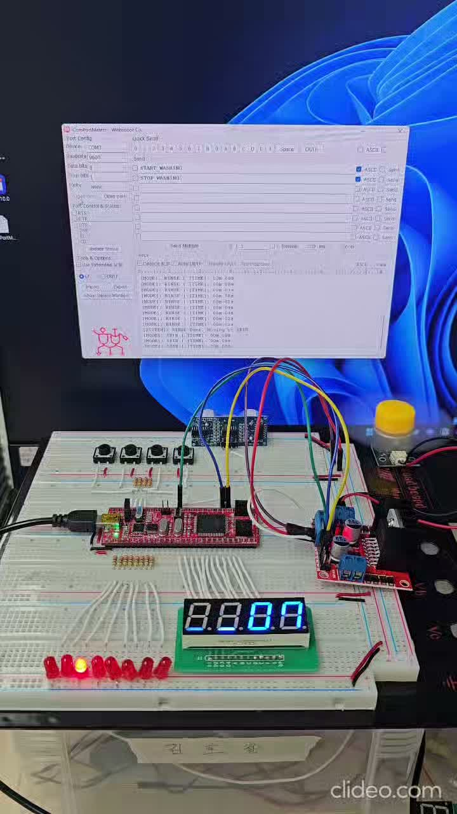
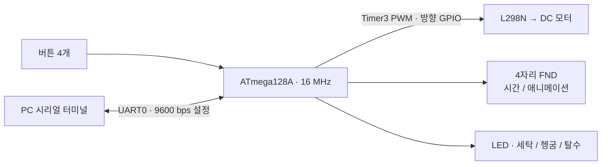

# AVR Washing Machine Controller

**ATmega128A로 세탁·헹굼·탈수 시퀀스를 제어하고, 버튼과 UART로 조작하는 임베디드 제어 프로젝트입니다.**

| 개발 | 담당 범위 | 기술 |
| --- | --- | --- |
| 2026.06 · 김호철 · 개인 프로젝트 | 회로 구성, AVR 펌웨어, 사용자 입출력 및 UART 연동 | C · ATmega128A · Timer Interrupt · PWM · UART · FSM |

  

<a href="https://github.com/user-attachments/assets/c99f2984-950a-4755-87bf-ce3245d4fa8f">시연 영상 보기 · 약 68초</a>

## 주요 기능

| 기능 | 구현 내용 |
| --- | --- |
| 공정 시퀀스 | 세탁 → 헹굼 → 탈수 순서로 진행하며, 각 단계의 시간 만료 시 다음 단계로 전환 |
| 시간 설정 | 버튼으로 공정별 분 값을 독립 설정 · 기본 시간은 각 10초 |
| 상태 표시 | LED로 공정 표시 · FND에 남은 시간과 회전 애니메이션 출력 |
| PC 제어 | UART로 `START_WASHING` / `STOP_WASHING` 수신 및 상태 로그 출력 |
| 모터 출력 | Timer3 하드웨어 PWM 사용 · 현재 세 공정 모두 설정값 `250`, 고정 방향 |

## 시스템 구성

## 핵심 설계

- **시스템 상태와 공정을 분리:** 대기·설정·실행 상태와 세탁·헹굼·탈수 공정을 별도로 관리합니다. 공정별 설정 시간을 실행용 시계에 복사해, 실행 중에도 설정값을 보존합니다.
- **시간 기준과 모터 파형을 별도 Timer에 배정:** Timer0 ISR은 tick을 누적하고 메인 루프가 시간·화면을 갱신합니다. Timer3는 모터 PWM 파형을 하드웨어에서 생성합니다.
- **수신과 명령 실행을 분리:** UART ISR에서 문장을 큐에 저장하고, 메인 루프에서 명령을 해석합니다. 버튼과 UART는 동일한 상태·공정 전환 함수를 사용합니다.

## 검증 범위와 현재 한계

전체 C 소스는 AVR GCC 5.4.0으로 `-Og`·`-Os` 컴파일 및 링크에 성공했고, `-Wall` 경고는 없었습니다. 기존 하드웨어 시연 영상과 UART 파형 자료를 함께 보관합니다.

현재 소스에는 **자동 완료 후 FND 함수 포인터 호출 문제와 JTAG 해제 레지스터 오류**가 남아 있습니다. 버튼 지연·UART 송신 대기로 실제 시간 오차가 생길 수 있으며, 이번 문서 정리에서는 보드 실행과 파형 재측정을 수행하지 않았습니다. 구체적인 근거와 재검증 항목은 [검증 기록](docs/verification.md)에 정리했습니다.

## 상세 문서

| 문서 | 내용 |
| --- | --- |
| [소프트웨어 설계](docs/architecture.md) | 상태 전환, 모듈 구성, 시간 처리와 UART 데이터 흐름 |
| [하드웨어·빌드·조작](docs/hardware-and-build.md) | 회로와 핀 매핑, 주변장치 설정, 빌드 및 사용 방법 |
| [검증 기록과 한계](docs/verification.md) | 빌드 결과, 시연·파형 자료의 범위, 알려진 문제 |
