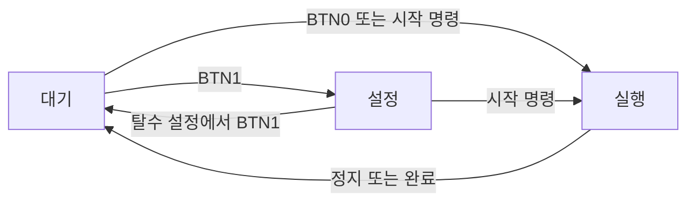

# 소프트웨어 설계

[README](../README.md) · [하드웨어·빌드·조작](hardware-and-build.md) · [검증 기록](verification.md)

## 상태와 공정을 분리한 제어

시스템은 `STATE_STANDBY`·`STATE_SETTING`·`STATE_RUNNING`으로 사용자 조작을 구분하고, `WASH`·`RINSE`·`SPIN`으로 현재 공정을 구분합니다. 각 공정은 같은 `washing_machine_t` 구조를 사용하므로, 전환 시 해당 공정의 시간과 PWM 설정을 공통 함수로 반영합니다.

설정 중에는 BTN1로 세탁 → 헹굼 → 탈수 → 대기 순서로 이동하고, BTN2로 선택 공정의 분 값을 바꿉니다. 실행 중에는 **WASH → RINSE → SPIN → 대기** 순서로 각 공정의 시간이 만료될 때 전환합니다. 시작·정지 명령은 각각 `START_WASHING`·`STOP_WASHING`입니다. 그림은 소스에 정의된 전환이며, 자동 완료 경로의 결함은 [검증 기록](verification.md)에 별도 기재했습니다.

| 데이터 | 역할 |
| --- | --- |
| `wash_step`, `rinse_step`, `spin_step` | 공정 종류·설정 시간·PWM 값 보관. 초기값은 모두 10초·250 |
| `current_mode` | 선택하거나 실행 중인 공정 |
| `running_clock` | 실행 시 설정 시간을 복사해 사용하는 카운트다운 값 |
| `current_time` | 설정 중에는 공정의 `set_time`, 실행 중에는 `running_clock` 참조 |

실행 중 시간을 차감해도 설정 원본은 유지됩니다. 정지 후 재시작하면 세탁부터 설정 시간으로 다시 시작하며, 일시정지·이어하기는 구현하지 않았습니다. 설정값은 RAM에만 있어 전원 재인가 시 초기값으로 돌아갑니다.

## 실행 컨텍스트와 처리 순서

| 컨텍스트 | 처리 | 공유 데이터 |
| --- | --- | --- |
| Timer0 overflow ISR | `TCNT0 = 6`, tick 증가 | `ms_count` |
| USART0 RX ISR | 1바이트 수신, 문장 조립, 큐 게시 | `rx_buff`, `rear`, `front` |
| 메인 루프 | 버튼 → tick 확인·시간/화면 갱신 → UART 명령 처리 | 상태·공정·실행 시간 및 수신 큐 |

상태 전환과 카운트다운은 메인 루프에서 실행합니다. ISR은 상태 전환 함수를 직접 호출하지 않습니다. `volatile`은 공유 값의 접근을 보존하지만, 8비트 MCU에서 32비트 `ms_count` 읽기의 원자성을 보장하지는 않습니다.

### 시간 처리

Timer0는 16 MHz·64분주·250카운트로 명목상 1ms tick을 만듭니다. 메인 루프는 tick 변화가 있으면 시간 갱신 함수를 한 번 실행하고, 호출 1,000회마다 초를 차감합니다. 상태 로그는 초 차감 직전에 출력됩니다.

경과 tick 수만큼 보정하지 않으므로 버튼의 15ms 지연과 UART polling 송신 동안 놓친 갱신이 누적될 수 있습니다. ISR 진입 후 카운터를 재설정하는 지연도 포함됩니다. 경과 시간 보정과 비차단 버튼·송신 처리는 구현되어 있지 않습니다.

### UART 수신과 명령 처리

수신 ISR은 `UDR0`에서 바이트를 읽고 CR 또는 LF에서 문장을 마감합니다. 한 칸을 비워 만석을 구분하므로 완료 문장의 최대 대기 수는 9개이고, 문장당 최대 79문자와 NULL을 저장합니다. `rear`는 ISR이, `front`는 메인 루프가 갱신합니다. 송신은 `printf` → `transmit_uart()` → UDRE0 polling으로 처리합니다.

- `START_WASHING`: 실행 상태가 아니면 설정 중에도 세탁부터 시작합니다.
- `STOP_WASHING`: 실행 중에만 대기로 전환합니다. 설정 모드에서는 빠져나오지 않습니다.
- 대소문자를 구분하며, 현재 비교는 완전 일치가 아닌 접두어 일치입니다.
- CRLF는 두 구분자로 처리되어 빈 문장도 큐에 들어갑니다.
- 만석이면 수신 바이트를 버리고 긴 문장은 잘라 저장합니다. 오류 응답·재전송·통신 타임아웃은 없습니다.

## 모듈과 출력

| 소스 | 주요 책임 |
| --- | --- |
| [main.c](../main.c) | 초기화, 상태·공정 전환, 시간 차감, 버튼 콜백, 로그 |
| [washing_machine.h](../washing_machine.h) | 상태 enum과 공정·시간 자료구조 |
| [button.c](../button.c) | PD3~PD6 스캔, 눌림·해제 시 15ms 지연, 해제 이벤트 반환 |
| [pwm.c](../pwm.c) | Timer3 PWM, 방향 GPIO, PWM 설정값 0~250 제한 |
| [fnd.c](../fnd.c) | 공통 애노드 FND 멀티플렉싱과 회전 패턴 |
| [led.c](../led.c) | 공정 번호에 해당하는 LED 한 개 점등 |
| [uart0.c](../uart0.c) | UART 초기화, 수신 큐, 명령 해석, polling 송신 |

설정 화면은 오른쪽 두 자리에 분 값만 표시합니다. 실행 화면은 분이 남아 있으면 분, 0분이면 초를 오른쪽 두 자리에 표시하고, 왼쪽 두 자리에 회전 패턴을 표시합니다. `MM:SS` 동시 표시가 아니며 애니메이션 역시 실제 모터 회전 피드백이 아닙니다.

Timer3는 메인 루프와 별개로 PWM을 생성하지만, 현재 모터 방향은 PF6=1·PF7=0으로 고정됩니다. 공정별 속도 필드는 존재하나 세 공정 모두 같은 값 250을 사용합니다.
