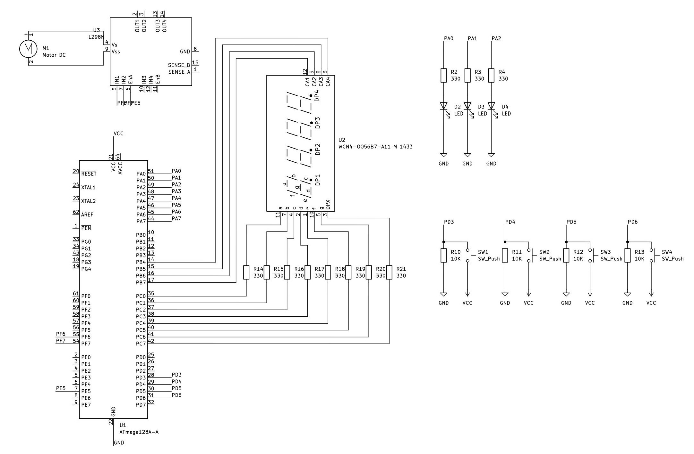

# 하드웨어·빌드·조작

[README](../README.md) · [소프트웨어 설계](architecture.md) · [검증 기록](verification.md)

## 하드웨어 구성

ATmega128A, L298N 모터 드라이버, DC 모터, 공통 애노드 4자리 FND, 버튼 4개, 공정 표시 LED를 사용합니다. 아래 그림은 저장소에 보관된 회로 자료입니다.



| 기능 | MCU 핀 | 연결·동작 |
| --- | --- | --- |
| BTN0~BTN3 | PD3, PD4, PD5, PD6 | 눌림 High, 외부 10 kΩ 풀다운. 내부 풀업은 코드에서 활성화하지 않음 |
| 공정 LED | PA0, PA1, PA2 | 세탁·헹굼·탈수 순서, High 점등 |
| FND 세그먼트 | PC0~PC7 | a~g·DP 데이터, 공통 애노드 설정에서 Low 점등 |
| FND 자리 선택 | PB7, PB6, PB5, PB4 | 1·10·100·1000 자리 순서, High 선택 |
| 모터 PWM | PE5 / OC3C | L298N ENA 입력 |
| 모터 방향 | PF6, PF7 | L298N IN1·IN2. 코드상 1·0으로 고정 |
| UART0 | PE0 / RXD0, PE1 / TXD0 | PC와 통신. 어댑터 TX→RXD0, RX←TXD0 및 공통 GND |

회로 그림은 전체 제작 배선을 대체하지 않습니다. 모터 전원·로직 전원, 공통 GND, 보드 클록과 프로그래머 연결은 실제 모듈에 맞춰 확인해야 합니다. 그림에는 FND 세그먼트 저항 8개와 LED 저항 3개가 각각 330 Ω으로 표시되어 있습니다. UART 변환기 종류, 전원 정격 및 실제 퓨즈 값은 저장소에서 확인되지 않습니다.

## 주변장치 설정

아래 계산은 실제 MCU 클록이 `F_CPU = 16000000UL`과 같고 레지스터가 리셋 상태에서 초기화되는 조건입니다. `F_CPU` 선언은 하드웨어 클록이나 퓨즈를 설정하지 않습니다.

| 자원 | 코드 설정 | 계산상 결과 |
| --- | --- | --- |
| Timer0 | Normal mode, 64분주, overflow ISR에서 `TCNT0=6` | `(256−6) × 64 / 16 MHz = 1ms`의 명목 tick |
| Timer3 C | Fast PWM 8bit, 비반전, 64분주, TOP=255 | `16 MHz / (64 × 256) = 976.5625 Hz` |
| UART0 | `U2X0=1`, `UBRR0=207` | `16 MHz / (8 × 208) ≈ 9615.38 bps`, 9600 대비 약 +0.16% |

UART 문자 형식은 관련 레지스터의 리셋 기본값인 8N1에 의존합니다. `uart0.h`의 baud 매크로를 바꾸는 것만으로는 속도가 바뀌지 않으며, 실제 초기화 값은 `uart0.c`에 고정되어 있습니다.

Timer 설정 및 레지스터 설명의 기준은 [ATmega128A 공식 데이터시트](https://ww1.microchip.com/downloads/en/DeviceDoc/Atmel-8151-8-bit-AVR-ATmega128A_Datasheet.pdf)입니다. GPIO 초기화의 알려진 오류와 PWM 0 설정의 경계는 [검증 기록](verification.md)을 먼저 확인하세요.

## 개발 환경과 빌드

| 항목 | 확인 내용 |
| --- | --- |
| 프로젝트 | [07.MY_WASHING_MACHINE.cproj](../07.MY_WASHING_MACHINE.cproj), Atmel Studio 7 형식 |
| 대상 | ATmega128A · AVR/GNU C · GNU99 |
| 로컬 확인 도구 | AVR GCC 5.4.0 / AVR Toolchain 3.6.2_1778 |
| Device Pack | ATmega_DFP 1.7.374 |
| 구성 | Debug `-Og`, Release `-Os` |

1. Atmel Studio 7 또는 호환되는 Microchip Studio에서 `.cproj`를 엽니다. 후자의 프로젝트 호환 실행은 이번 검증에 포함하지 않았습니다.
2. 대상 MCU와 Device Pack을 확인하고 Debug 또는 Release 구성을 선택합니다.
3. **Build → Build Solution**을 실행합니다. `Debug/` 또는 `Release/` 산출물은 로컬에서 생성하며 Git에는 포함하지 않습니다.
4. 실제 프로그래머와 연결 방식에 맞춰 Device Programming을 설정하고 생성된 HEX를 기록합니다. 프로그래머 모델·퓨즈 값은 확인 자료가 없어 임의 지정하지 않습니다.

이번에 확인한 빌드는 IDE 실행이 아니라, 프로젝트의 MCU·Device Pack·주요 컴파일 옵션을 적용한 명령행 전체 컴파일·링크입니다. 생성 Makefile은 머신별 절대경로를 포함하므로 추적에서 제외하고 IDE가 재생성하도록 합니다.

## 버튼으로 조작하기

버튼 이벤트는 **눌렀다 놓을 때** 발생합니다.

| 버튼 | 대기 | 설정 | 실행 |
| --- | --- | --- | --- |
| BTN0 | 세탁부터 시작 | 동작 없음 | 정지 후 대기 |
| BTN1 | 세탁 시간 설정 진입 | 세탁 → 헹굼 → 탈수 → 대기 | 동작 없음 |
| BTN2 | 동작 없음 | 선택 공정의 분 값 +1, 59 다음 0 | 동작 없음 |
| BTN3 | 동작 없음 | 동작 없음 | 동작 없음 |

초기 시간은 공정별 `00분 10초`입니다. BTN2는 초를 변경하지 않으므로 한 번 누르면 `01분 10초`가 됩니다. 버튼으로 설정을 마친 뒤 대기로 돌아와 BTN0를 누르면 시작됩니다. 설정값은 전원을 끄면 유지되지 않습니다.

## PC에서 조작하기

시리얼 터미널은 **9600 bps · 8 data bits · no parity · 1 stop bit**, 별도 하드웨어 흐름 제어 없이 사용합니다. 포트 번호는 PC에서 확인합니다. 명령 뒤에는 CR 또는 LF 중 하나를 붙입니다.

```text
START_WASHING
STOP_WASHING
```

소문자 `start`·`stop`은 현재 명령이 아닙니다. 시작은 대기·설정 상태에서 허용되며 실행 중에는 다시 시작하지 않습니다. 정지는 실행 상태에서만 유효합니다.

아래는 **코드 형식에 따른 예시**이며, 이번에 수집한 실행 로그는 아닙니다.

```text
UART Rx: START_WASHING
[MODE]: WASH | [TIME]: 00m 10s
[MODE]: WASH | [TIME]: 00m 09s
[SYSTEM]: WASH Done. Moving to RINSE.
```

상태 로그는 초를 차감하기 전에 출력됩니다. 정지·완료 응답 및 로그만으로 모터의 물리적 정지나 시간 정확성을 판정할 수는 없습니다.
