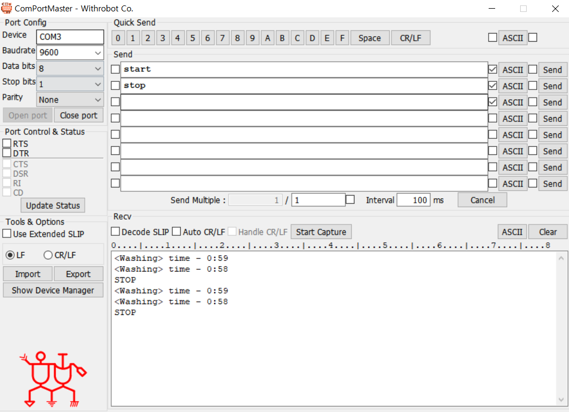
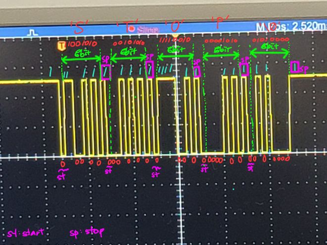

# 검증 기록과 한계

[README](../README.md) · [소프트웨어 설계](architecture.md) · [하드웨어·빌드·조작](hardware-and-build.md)

## 확인 범위

문서 기준일은 2026-10-30입니다. 현재 소스 정적 검토·로컬 빌드와 기존 촬영 자료를 구분했습니다. 이번 문서 개편에서는 펌웨어 동작을 수정하거나 실제 보드에 업로드하지 않았습니다.

| 구분 | 확인 내용 | 판정 범위 |
| --- | --- | --- |
| 소스 검토 | C 소스 6개·헤더 6개, 프로젝트 설정 | 상태 전환·핀 매핑·명령 형식 확인, 아래 결함 발견 |
| 로컬 빌드 | AVR GCC 5.4.0, ATmega_DFP 1.7.374, GNU99, `-Wall` | `-Og`·`-Os` 전체 컴파일·링크 성공, 경고 없음 |
| 기존 영상 | 약 68초 영상의 대표 프레임 확인 | 하드웨어 구성·FND·LED·PC 로그 화면 관찰. 현 소스와 동일 바이너리인지는 미확인 |
| 기존 이미지 | 회로·터미널·오실로스코프 자료 | 설계·촬영 참고 자료. 일부 명령·로그가 현재 코드와 다름 |
| 이번 보드 검증 | 미수행 | 카운트다운 정확도, 모터 정지, UART 스트레스 및 GPIO 파형은 미검증 |

빌드 성공은 하드웨어에서의 정상 동작이나 알려진 결함의 해소를 의미하지 않습니다.

## 빌드 결과

프로젝트 설정의 `-funsigned-char`, `-funsigned-bitfields`, `-fpack-struct`, `-fshort-enums`, `-mrelax`, 함수·데이터 섹션 분리와 링크 시 미사용 섹션 제거를 적용했습니다. 전체 소스 6개를 각각 컴파일하고 ELF로 링크했습니다. 산출물은 저장소 밖 임시 폴더에서 생성했습니다.

| 최적화 | text | data | bss | Flash: text + data | 정적 RAM: data + bss |
| --- | ---: | ---: | ---: | ---: | ---: |
| `-Og` | 3,908 B | 298 B | 838 B | 4,206 B | 1,136 B |
| `-Os` | 3,744 B | 304 B | 838 B | 4,048 B | 1,142 B |

수치는 `avr-size` 기준이며 RAM 사용량에는 실행 중 stack이 포함되지 않습니다. UART 수신 배열 자체가 800바이트를 사용합니다. 이 결과는 최적화 설정을 바꾼 명령행 검증이며 IDE Debug·Release 실행 검증은 아닙니다.

## 기존 시연 자료

[전체 영상 보기](https://github.com/user-attachments/assets/c99f2984-950a-4755-87bf-ce3245d4fa8f)

대표 이미지는 기존 영상 약 25초 지점에서 추출했습니다. 영상에는 제어 보드, 버튼, LED, FND, 모터 드라이버와 시리얼 터미널이 나타납니다. 영상의 화면 표시만으로 PWM 듀티·회전수·실시간 정확도 또는 현재 소스의 결함 부재를 입증하지 않습니다.

### UART 터미널과 파형

이 캡처의 `start`·`stop` 및 `<Washing> time` 표기는 현재 소스의 `START_WASHING`·`STOP_WASHING`, `[MODE]`·`[TIME]` 형식과 다릅니다. 현재 명령 사용법은 [하드웨어·빌드·조작](hardware-and-build.md)을 기준으로 합니다.

파형은 수기 주석이 포함된 기존 UART 관찰 자료입니다. 9600 bps의 이상적인 비트 시간은 약 104.17 µs이고, 현재 UBRR 설정의 계산값은 약 104 µs입니다. 캡처만으로 정확한 실측값·오차·장시간 무손실을 확정하지 않으며, 원시 파형과 측정 조건은 저장소에서 확인되지 않습니다.

현재 코드의 상태 전환은 [소프트웨어 설계의 상태도](architecture.md)에 정리했습니다.

## 알려진 문제와 구현 경계

아래는 현재 코드에서 확인한 내용입니다. 개선 제안은 아직 구현·검증하지 않았습니다.

| 항목 | 현재 근거와 영향 | 필요한 개선·확인 |
| --- | --- | --- |
| 자동 완료 후 함수 포인터 호출 | `main.c`에서 탈수 완료로 대기 전환 후 `fnd_mode_funcs[STATE_STANDBY]` 호출 가능. 해당 원소는 `NULL` | 공정 전환 후 상태 재확인 또는 유효한 함수 검사, 완료 경로 재검증 |
| JTAG 해제 레지스터 오류 | `fnd.c`가 `MCUCR`에 `JTD` 비트 번호 7을 씀. 대상 MCU에서 JTD는 `MCUCSR`에 있고, MCUCR bit 7은 외부 메모리 활성화 SRE | 올바른 레지스터·시간 제한 쓰기 확인, PORTA·PORTC 및 PF6·PF7 기능·퓨즈 대조 |
| 시간 누락 | 버튼의 15ms 지연과 UART polling 송신 동안에도 tick은 증가하지만, 메인은 경과량과 무관하게 1회 갱신 | 경과량 처리와 비차단 입출력 검토, 벽시계 대비 오차 측정 |
| tick 원자성 | ISR이 쓰는 32비트 `ms_count`를 메인이 원자성 보호 없이 읽음 | 원자적 snapshot 적용 및 경계 시점 확인 |
| UART 과부하·문장 검증 | 큐 만석 시 바이트 폐기, 79문자 이후 잘림, 접두어 명령 허용, CRLF의 빈 문장 생성 | 초과 문장 폐기·경계 재동기화·완전 일치 검증과 스트레스 시험 |
| PWM 0의 의미 | 정지는 `OCR3C=0` 요청이며 방향은 유지. Fast PWM은 OCR=0에서 좁은 펄스가 남는 경계 동작이 있음 | OC 출력·드라이버 입력 측정, 확실한 비활성화 방식 검토 |
| 출력 제어 경계 | `fnd_digit_on()`이 PORTB 전체를 대입하고 자리 소등 없이 세그먼트를 먼저 변경 | 다른 PB 핀 공유 및 잔상 영향 확인 |
| 기능 범위 | BTN3 미사용, 시간의 초 설정·설정 저장·일시정지·역회전·회전수 피드백 없음 | 현재 구현 범위로 명시, 추가 기능과 구분 |

JTD·SRE 및 Fast PWM의 OCR=0 경계는 [ATmega128A 공식 데이터시트](https://ww1.microchip.com/downloads/en/DeviceDoc/Atmel-8151-8-bit-AVR-ATmega128A_Datasheet.pdf)의 MCUCR, MCUCSR, Fast PWM 설명과 대조했습니다. 물리적 영향은 보드에서 별도 확인해야 합니다.

## 다음 보드 검증 항목

| 시나리오 | 확인할 결과 |
| --- | --- |
| 초기화와 핀 기능 | XMEM·JTAG 설정, 각 LED·FND 자리·방향 출력이 핀 매핑대로 동작 |
| 설정 후 재시작 | 공정별 설정 유지, 세탁부터 시작, 재인가 시 기본값 복귀 |
| 자동 완료 | 세 공정 순차 실행 후 추가 함수 호출 오류 없이 대기 유지 |
| 정지 | BTN0·UART 각각의 처리 지연과 실제 드라이버 출력·모터 정지 확인 |
| 시간과 통신 부하 | 무입력·버튼 반복·UART 연속 입력 조건의 경과 시간 비교 |
| UART 경계 | CR·LF·CRLF, 잘못된 명령, 긴 문장, 큐 만석 후 다음 정상 명령 처리 |

